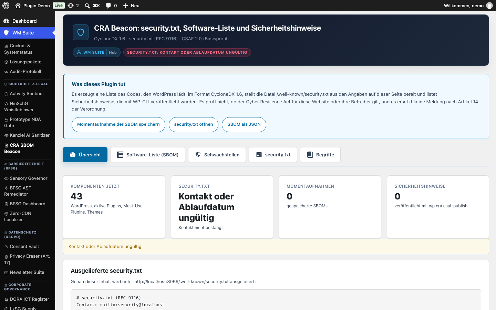
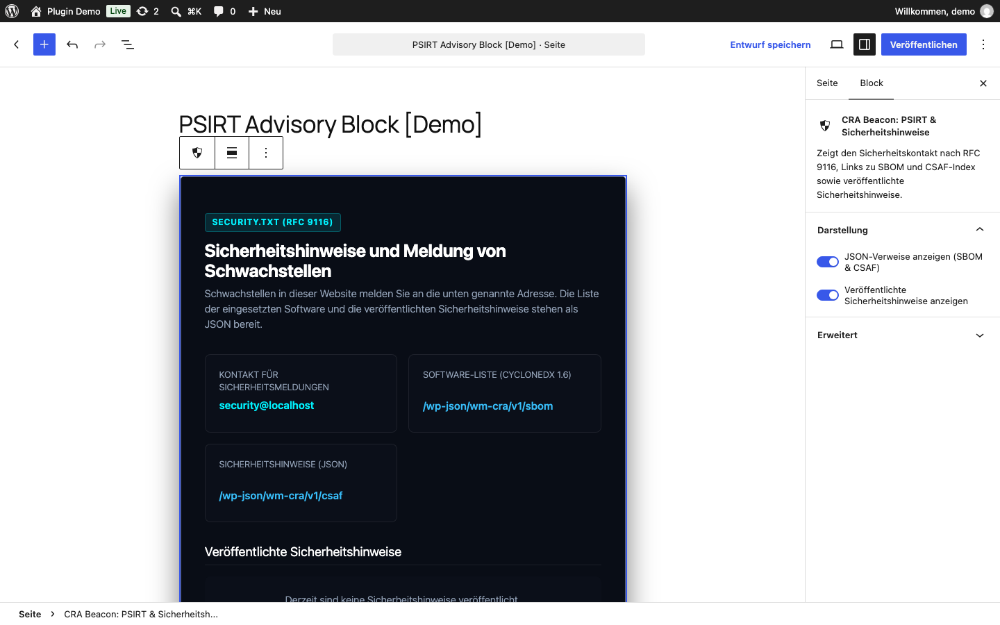
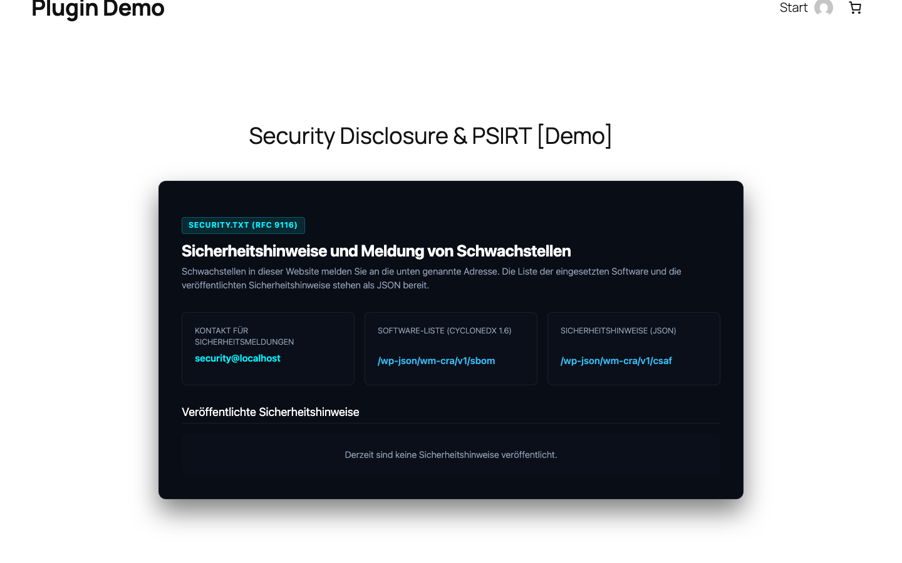

# WM CRA SBOM & Vulnerability Beacon (Deutsche Dokumentation)

<p align="center">
  <a href="README.md"></a>
  <a href="README.de.md"></a>
  <a href="README.es.md"></a>
</p>

**Version:** 1.2.2 · **WordPress:** 6.4+ · **Getestet bis:** 7.1 · **PHP:** 8.2+ · **Lizenz:** [GPLv2 or later](https://www.gnu.org/licenses/gpl-2.0.html) (`GPL-2.0-or-later`) · **UI-Sprachen:** 28 Sprachpakete · **Plugin-Seite:** [https://arnoldwender.com/wordpress-plugins/wm-cra-sbom-beacon/](https://arnoldwender.com/wordpress-plugins/wm-cra-sbom-beacon/)

WordPress-Plugin, das den aktiven Code einer Website als CycloneDX-1.6-JSON-Inventar erfasst, `/.well-known/security.txt` (RFC 9116) aus den Backend-Einstellungen ausliefert und Sicherheitshinweise als CSAF-2.0-Dokumente (Basis-Profil) speichert.

Dieses Dokument beschreibt ausschließlich das tatsächlich ausgelieferte Verhalten laut Code ([README.md](README.md)). Frühere Marketing-Banner und UI-Mockups mit nicht vorhandenen Bildschirmen wurden am 20.11.2026 außerhalb des Repositorys archiviert (Release 1.2.0).

> **Plugin-Seite:** [https://arnoldwender.com/wordpress-plugins/wm-cra-sbom-beacon/](https://arnoldwender.com/wordpress-plugins/wm-cra-sbom-beacon/)  
> **Mit einem agentischen Workflow entwickelt:** entstanden mit KI-Coding-Agenten. Prüfen und testen Sie es wie jeden fremden Code, bevor Sie es produktiv einsetzen.  
> **Support & Haftung:** Kein Support (Zero Support) — reproduzierbare Bugs ausschließlich über [GitHub Issues](https://github.com/arnoldwender/wm-wp-cra-sbom-beacon/issues) · kein privater Support · OHNE GEWÄHR („AS IS“) / keine Haftung ([SUPPORT.md](SUPPORT.md))

## Live-Vorschau

!WM CRA SBOM & Vulnerability Beacon Banner

| Admin-Übersicht | Block-Editor | Öffentliche Sicherheitsseite |
|---|---|---|
|  |  |  |

## Was das Plugin leistet

- **Software-Inventar (SBOM):** `GET /wp-json/wm-cra/v1/sbom`, `wp cra sbom-generate` und der Admin-Tab erstellen ein CycloneDX-1.6-JSON-Dokument für WordPress-Kern, aktive Plugins (Einzelwebsite und Netzwerk), Must-Use-Plugins sowie aktives Theme samt Eltern-Theme. Name, Version, Autor und Lizenz stammen aus den Datei-Headern; fehlende Angaben werden ausgelassen. Datei-Hashes werden nicht berechnet. Alle vier JSON-REST-Routen (`/sbom`, `/spdx`, `/vex`, `/csaf`) verlangen standardmäßig `manage_options` oder einen Timing-sicheren `Authorization: Bearer <token>`-Header (in `wp_options` liegt nur der SHA-256-Hash des Tokens, alternativ `WM_CRA_API_TOKEN` in `wp-config.php`), cachen Antworten für eine Stunde in Transients mit automatischer Invalidierung bei Plugin-, Theme-, Upgrader- oder Hinweisänderungen und bieten einen expliziten öffentlichen Opt-in-Modus mit Limit auf 60 Anfragen/Minute je gesalzenem IP-Hash.
- **Gebündelte Bibliotheken:** Composer-Pakete und npm-Abhängigkeiten aus `composer.lock` und `package-lock.json` der erfassten Plugins und Themes mit `pkg:composer/`- und `pkg:npm/`-PURLs. Es werden nur Lockfiles gelesen, keine Manifeste; Entwicklungsabhängigkeiten und Lockfiles innerhalb von `vendor/` oder `node_modules` werden ignoriert.
- **Laufzeitumgebung:** PHP-Version, geladene Erweiterungen mit eigenem Veröffentlichungszyklus (für `openssl` und `curl` die echte Bibliotheks-Version statt der PHP-Version), Datenbankserver (MariaDB wird nicht als MySQL gemeldet) und Webserver-Banner.
- **Schwachstellenprüfung (`wp cra vuln-scan`, täglicher Cron, Tab *Schwachstellen*):** Composer- und npm-Pakete werden gesammelt gegen **OSV** geprüft, WordPress-Kern, Plugins und Themes gegen **NVD** anhand der CPE-Versionsbereiche der jeweiligen CVE. Jede Quelle wird nur nach Daten gefragt, die sie tatsächlich führt (OSV liefert für WordPress-Ökosysteme `{}`).
- **Kein stiller „Clean“-Standard:** Ohne API-Schlüssel begrenzt NVD auf fünf Anfragen pro 30 Sekunden; ein Cursor merkt sich den Stand. Jede Komponente trägt einen berechneten Status (`checked` mit Zeitstempel, `never_checked`, `unknown_version` oder `source_error`).
- **Kryptografisches Inventar (CBOM), standardmäßig aus:** Über *Kryptografische Verfahren mitaufnehmen* oder `wp cra sbom-generate --crypto` erfasst das Dokument Hash-Algorithmen, Chiffren und TLS-Versionen des Hosts als CycloneDX-`cryptographic-asset`-Komponenten.
- **Snapshots:** Admin-Schaltfläche, `wp cra sbom-generate --snapshot` und die Hub-Aktion speichern das JSON samt SHA-256 in der Tabelle `wm_cra_sbom_snapshots`; der Admin-Tab zeigt die zehn neuesten Einträge.
- **security.txt:** `/.well-known/security.txt` (und `/security.txt`) liefert Contact, Expires, Encryption, Preferred-Languages, Canonical und Policy aus fünf Optionen sowie zwei Kommentarzeilen auf die JSON-Ausgaben, filterbar über `wm_cra_security_txt_output`. Ungültige Formulareingaben verhindern die Speicherung vollständig.
- **Berechneter Dateistatus:** Admin-Kopfzeile, Widget, Hub-Status, Block Bindings (`wm-cra-beacon/status`), GenerateBlocks-2.x-Dynamic-Tag (`{{wm_cra_beacon_status}}`) und Selbsttest melden einen berechneten Status (`ok`, `expiring`, `expired`, `invalid`, `no_route` oder `not_configured`). Der bei Aktivierung gesetzte Platzhalter `security@<host>` gilt bis zum ersten Speichern als unbestätigt.
- **Sicherheitshinweise (Advisories):** `wp cra csaf-publish <id> --title=… --severity=low|medium|high|critical [--cve=…] [--description=…]` speichert CSAF-2.0-Dokumente (`csaf_base`) mit Revisionshistorie. Ohne `--cve` wird keine CVE gesetzt und kein CVSS-Wert berechnet.
- **SPDX 3.0.1 (`GET /wp-json/wm-cra/v1/spdx`, `wp cra spdx-generate`):** Dieselbe Erfassung als JSON-LD gegen den Kontext 3.0.1 (`software_Package`, `software_packageVersion`, `software_packageUrl`, `contains`, `software_Sbom`). Freitext-Lizenzangaben landen in `comment`.
- **OpenVEX (`GET /wp-json/wm-cra/v1/vex`, `wp cra vex`):** Position zu Befunden als OpenVEX v0.2.0 (`under_investigation` für ungeprüfte Befunde, `not_affected` nur mit Begründung oder Auswirkungsangabe, `affected` nur mit Maßnahmenangabe).
- **Hinweis-Index:** `GET /wp-json/wm-cra/v1/csaf` listet die neuesten 50 Dokumente als einfachen JSON-Index (kein CSAF-`provider-metadata.json` und kein ROLIE-Feed).
- **Öffentliche Box, Gutenberg-Block & dynamische Bindings:** Shortcodes `[wm_cra_psirt]` und `[wm_security_disclosure]` sowie der Block `wm/cra-psirt` (`blocks/cra-psirt/block.json` + `build/index.js` mit `InspectorControls` und `ServerSideRender`), Block Bindings `wm-cra-beacon/status` und Dynamic Tag `{{wm_cra_beacon_status}}`.
- **Dashboard-Widget, WP-CLI, Hooks & WM Suite Hub:** Action `wm_cra_beacon_ready`, Filter `wm_cra_security_txt_output` und `wm_cra_sbom_include_crypto`, Hub-Status, Telemetrie, Aktionen `self_test` und `generate_sbom`.
- **Deinstallation (`D-UNINSTALL`):** Bewahrt standardmäßig alle Optionen und die drei Tabellen (`wm_cra_sbom_snapshots`, `wm_cra_advisories`, `wm_cra_vulnerabilities`), sofern `wm_cra_beacon_delete_data_on_uninstall` nicht explizit aktiviert wird.

Alle Stylesheets und das Block-Editor-Skript werden lokal mit dem Plugin ausgeliefert (Zero-CDN, keine externen Anfragen).

## Was das Plugin nicht leistet

- **Keine rechtliche Prüfung:** Prüft nicht, ob die Cyber-Resilience-Verordnung (EU) 2024/2847 anwendbar ist, und erstellt keine Konformitätsbewertung. Siehe [docs/LEGAL-COMPLIANCE.md](docs/LEGAL-COMPLIANCE.md).
- **Kein Meldewesen:** Artikel-14-CRA-Meldungen (24 h, 72 h, 14 Tage) sind nicht enthalten.
- **Kein CSAF-Provider:** Kein `provider-metadata.json`, kein ROLIE-Feed, keine signierten Dokumente.
- **Kein umfassender WordPress-Plugin-Schwachstellenscanner:** NVD indexiert deutlich weniger WordPress-Plugin-CVEs als kommerzielle Feeds mit API-Schlüssel; ein dort fehlendes Plugin ohne Treffer in NVD ist nicht automatisch frei von Sicherheitslücken.
- **Keine eigene CVSS-Berechnung** und **keine vollständige Abhängigkeitsliste** bei fehlenden Lockfiles oder inaktiven Plugins.

## Schnellstart

```bash
wp plugin activate wm-cra-sbom-beacon
wp cra security-txt
wp cra sbom-generate --output=/tmp/sbom.json
```

Öffnen Sie anschließend *CRA Beacon (SBOM) › security.txt* im wp-admin, tragen Sie einen echten Kontakt sowie ein Ablaufdatum ein und speichern Sie das Formular.

## Tests

```bash
php tests/test-suite.php
bash tests/run-mutations.sh
php tests/test-pot-freshness.php
cd tests && ../vendor/bin/phpunit --configuration phpunit.xml.dist
wp eval-file tests/wp-runtime-cra.php --user=1
```

## Bekannte Einschränkungen

- **Websites mit Aktivierung vor dem 15.09.2026** können eine vorausgefüllte Policy-URL `/security-policy` tragen (`http://` ohne TLS wird beim Speichern abgewiesen); die Datei bleibt bis zum Speichern unbestätigt.
- **Gestaltung der öffentlichen Box:** Das Shortcode-/Block-Markup nutzt eigene Inline-Farben und -Größen außerhalb der Admin-Design-Tokens.
- **Übersetzungen:** Alle 28 ausgelieferten Sprachkataloge (`.po`, `.mo` und JED-`.json` für `build/index.js`) decken 163 UI-Texte ab und werden über `tests/test-pot-freshness.php` gegen `languages/wm-cra-sbom-beacon.pot` geprüft.

## Dokumentation

- [README.md](README.md) (englische Referenz)
- [docs/ARCHITECTURE.md](docs/ARCHITECTURE.md)
- [docs/DEVELOPER-GUIDE.md](docs/DEVELOPER-GUIDE.md)
- [docs/LEGAL-COMPLIANCE.md](docs/LEGAL-COMPLIANCE.md)
- [CHANGELOG.md](CHANGELOG.md)

## Lizenz

Lizenziert unter der **GNU General Public License v2 or later** (`GPLv2 or later` / SPDX `GPL-2.0-or-later`). Siehe [LICENSE](LICENSE).
