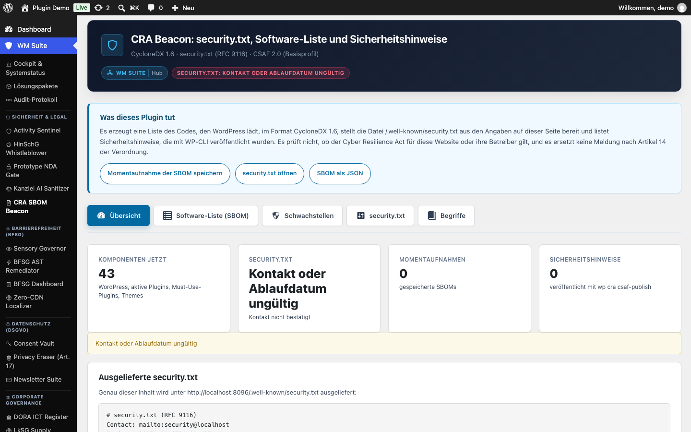
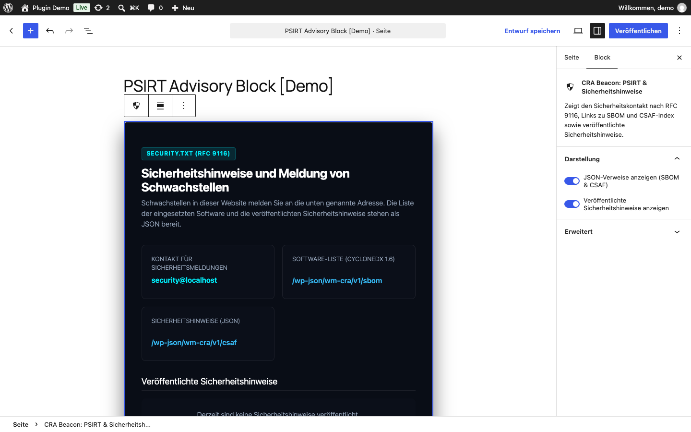
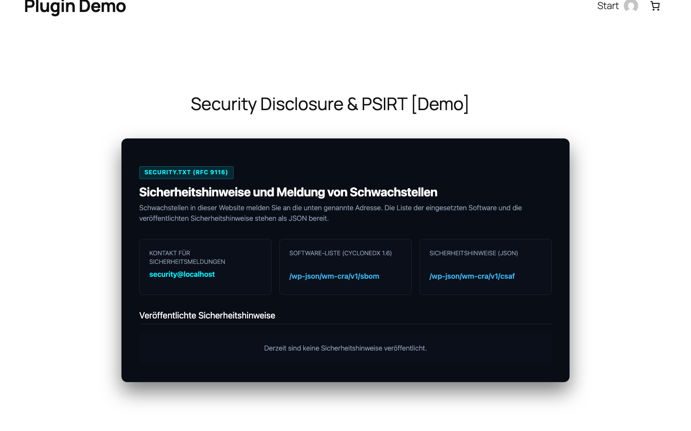

# WM CRA SBOM & Vulnerability Beacon (Documentación en Español)

<p align="center">
  <a href="README.md"></a>
  <a href="README.de.md"></a>
  <a href="README.es.md"></a>
</p>

**Versión:** 1.2.2 · **WordPress:** 6.4+ · **Probado hasta:** 7.1 · **PHP:** 8.2+ · **Licencia:** [GPLv2 or later](https://www.gnu.org/licenses/gpl-2.0.html) (`GPL-2.0-or-later`) · **Idiomas de interfaz:** 28 locales · **Página del Plugin:** [https://arnoldwender.com/es/plugins-wordpress/wm-cra-sbom-beacon/](https://arnoldwender.com/es/plugins-wordpress/wm-cra-sbom-beacon/)

Plugin para WordPress que inventaría el código activo del sitio en formato CycloneDX 1.6 JSON, sirve `/.well-known/security.txt` (RFC 9116) desde los ajustes de administración y almacena avisos de seguridad como documentos CSAF 2.0 (perfil base).

Este documento describe únicamente las capacidades implementadas en el código ([README.md](README.md)). Los banners y maquetas anteriores se archivaron fuera del repositorio el 20/11/2026 (versión 1.2.0).

> **Página del plugin:** [https://arnoldwender.com/es/plugins-wordpress/wm-cra-sbom-beacon/](https://arnoldwender.com/es/plugins-wordpress/wm-cra-sbom-beacon/)  
> **Desarrollado con un agentic workflow:** creado con agentes de programación de IA. Revísalo y pruébalo como cualquier código de terceros antes de usarlo en producción.  
> **Soporte y responsabilidad:** Cero soporte (Zero Support) — errores reproducibles únicamente en [GitHub Issues](https://github.com/arnoldwender/wm-wp-cra-sbom-beacon/issues) · sin soporte privado · TAL CUAL («AS IS») / sin responsabilidad ([SUPPORT.md](SUPPORT.md))

## Capturas en vivo

!Banner de WM CRA SBOM & Vulnerability Beacon

| Resumen del panel | Editor de Bloques | Portal Público |
|---|---|---|
|  |  |  |

## Qué hace el plugin

- **Inventario de software (SBOM):** `GET /wp-json/wm-cra/v1/sbom`, `wp cra sbom-generate` y la pestaña de administración generan un documento CycloneDX 1.6 JSON con el núcleo de WordPress, plugins activos (sitio y red), must-use plugins y tema activo junto con su tema padre. Nombre, versión, autor y licencia proceden de las cabeceras de archivo; los campos ausentes se omiten y no se calculan hashes de archivos. Las cuatro rutas JSON REST (`/sbom`, `/spdx`, `/vex`, `/csaf`) exigen `manage_options` o cabecera `Authorization: Bearer <token>` con comparación segura por tiempo por defecto (solo se guarda el hash SHA-256 del token en `wp_options`, o `WM_CRA_API_TOKEN` en `wp-config.php`), guardan respuesta en caché transient de 1 hora invalidada automáticamente ante cambios en plugins, temas, actualizaciones o avisos, y ofrecen un modo público opcional limitado a 60 peticiones/min por hash de IP con sal.
- **Bibliotecas incluidas:** Paquetes Composer y dependencias npm leídos exclusivamente desde `composer.lock` y `package-lock.json` con identificadores `pkg:composer/` y `pkg:npm/`. Se ignoran manifiestos de rangos, dependencias de desarrollo y lockfiles dentro de `vendor/` o `node_modules`.
- **Entorno de ejecución:** Versión de PHP, extensiones cargadas con ciclo de versiones propio (`openssl` y `curl` consultan la versión real de la biblioteca), servidor de base de datos (MariaDB no se notifica como MySQL) y cabecera del servidor web.
- **Auditoría de vulnerabilidades (`wp cra vuln-scan`, cron diario, pestaña *Schwachstellen*):** Los paquetes Composer y npm se consultan por lotes en **OSV**, y el núcleo, plugins y temas de WordPress en **NVD** contrastando los rangos CPE de cada CVE. Cada fuente se consulta solo sobre los ecosistemas que realmente indexa.
- **Ningún componente es limpio por defecto:** Sin clave API, NVD limita a cinco peticiones cada 30 segundos y un cursor reanuda el recorrido. Cada componente conserva su estado calculado (`checked` con marca temporal, `never_checked`, `unknown_version` o `source_error`).
- **Inventario criptográfico (CBOM), desactivado por defecto:** Con la opción de procedimientos criptográficos o `wp cra sbom-generate --crypto`, el documento incluye algoritmos hash, cifrados y versiones TLS del host como componentes `cryptographic-asset`.
- **Instantáneas (Snapshots):** El botón de administración, `wp cra sbom-generate --snapshot` y la acción del Hub guardan el JSON junto con su SHA-256 en la tabla `wm_cra_sbom_snapshots`; la pestaña lista las diez más recientes.
- **security.txt:** `/.well-known/security.txt` (y `/security.txt`) sirve Contact, Expires, Encryption, Preferred-Languages, Canonical y Policy desde cinco opciones más dos líneas de comentario hacia los JSON, filtrable mediante `wm_cra_security_txt_output`. Si algún campo no es válido no se guarda ningún cambio.
- **Estado calculado:** Cabecera admin, widget, estado del Hub, Block Bindings (`wm-cra-beacon/status`), etiqueta dinámica de GenerateBlocks 2.x (`{{wm_cra_beacon_status}}`) y autodiagnóstico informan un estado real (`ok`, `expiring`, `expired`, `invalid`, `no_route` o `not_configured`). El contacto creado al activar (`security@<host>`) permanece como no confirmado hasta guardar el formulario.
- **Avisos de seguridad (Advisories):** `wp cra csaf-publish <id> --title=… --severity=low|medium|high|critical [--cve=…] [--description=…]` guarda documentos CSAF 2.0 (`csaf_base`) con historial de revisiones sin inventar CVE ni puntuaciones CVSS.
- **SPDX 3.0.1 (`GET /wp-json/wm-cra/v1/spdx`, `wp cra spdx-generate`):** Misma medición en JSON-LD conforme al contexto 3.0.1 (`software_Package`, `software_packageVersion`, `software_packageUrl`, `contains`, `software_Sbom`).
- **OpenVEX (`GET /wp-json/wm-cra/v1/vex`, `wp cra vex`):** Postura sobre hallazgos en formato OpenVEX v0.2.0 (`under_investigation` por defecto para hallazgos sin revisar, `not_affected` solo con justificación o impacto, `affected` solo con plan de acción).
- **Índice de avisos:** `GET /wp-json/wm-cra/v1/csaf` lista los 50 documentos más recientes en un índice JSON sencillo (no es `provider-metadata.json` ni feed ROLIE).
- **Caja pública, bloque Gutenberg y bindings dinámicos:** Shortcodes `[wm_cra_psirt]` y `[wm_security_disclosure]`, bloque `wm/cra-psirt` (`blocks/cra-psirt/block.json` + `build/index.js` con `InspectorControls` y `ServerSideRender`), Block Bindings `wm-cra-beacon/status` y etiqueta GenerateBlocks `{{wm_cra_beacon_status}}`.
- **Widget, WP-CLI, hooks y módulo WM Suite Hub:** Acción `wm_cra_beacon_ready`, filtros `wm_cra_security_txt_output` y `wm_cra_sbom_include_crypto`, salud del Hub, telemetría y acciones `self_test` y `generate_sbom`.
- **Desinstalación (`D-UNINSTALL`):** Conserva por defecto opciones y las tres tablas (`wm_cra_sbom_snapshots`, `wm_cra_advisories`, `wm_cra_vulnerabilities`) salvo que el administrador active expresamente `wm_cra_beacon_delete_data_on_uninstall`.

Todas las hojas de estilo y el script del editor de bloques se incluyen en local con el plugin (Zero-CDN, sin peticiones externas de recursos).

## Qué no incluye

- **Sin evaluación jurídica:** No evalúa la aplicabilidad del Reglamento (UE) 2024/2847 (CRA) ni genera documentación de conformidad. Véase [docs/LEGAL-COMPLIANCE.md](docs/LEGAL-COMPLIANCE.md).
- **Sin notificaciones regulatorias:** No cubre las notificaciones del artículo 14 CRA (24 h, 72 h, 14 días).
- **No es proveedor CSAF:** Sin `provider-metadata.json`, sin feed ROLIE y sin firma de documentos.
- **No sustituye a feeds comerciales de vulnerabilidades WordPress:** NVD indexa menos vulnerabilidades de plugins WordPress que feeds privados con clave API; ausencia de hallazgos en NVD no equivale a ausencia de vulnerabilidades.
- **Sin cálculo propio de CVSS** ni **listado completo de dependencias** sin lockfiles o en plugins inactivos.

## Inicio rápido

```bash
wp plugin activate wm-cra-sbom-beacon
wp cra security-txt
wp cra sbom-generate --output=/tmp/sbom.json
```

A continuación abre *CRA Beacon (SBOM) › security.txt* en wp-admin, introduce un contacto real y una fecha de expiración válida y guarda los cambios.

## Pruebas

```bash
php tests/test-suite.php
bash tests/run-mutations.sh
php tests/test-pot-freshness.php
cd tests && ../vendor/bin/phpunit --configuration phpunit.xml.dist
wp eval-file tests/wp-runtime-cra.php --user=1
```

## Limitaciones conocidas

- **Sitios activados antes del 15/09/2026** pueden conservar una URL de política inicial `/security-policy` (`http://` sin TLS, rechazada al guardar); el archivo permanece sin confirmar hasta guardar el formulario.
- **Estilos de la caja pública:** El marcado del shortcode/bloque conserva colores y tamaños propios en lugar de tokens de diseño del panel admin.
- **Traducciones:** Los 28 catálogos de idioma (`.po`, `.mo` y JED `.json` para `build/index.js`) cubren las 163 cadenas de interfaz y se validan mediante `tests/test-pot-freshness.php`.

## Documentación

- [README.md](README.md) (referencia en inglés)
- [docs/ARCHITECTURE.md](docs/ARCHITECTURE.md)
- [docs/DEVELOPER-GUIDE.md](docs/DEVELOPER-GUIDE.md)
- [docs/LEGAL-COMPLIANCE.md](docs/LEGAL-COMPLIANCE.md)
- [CHANGELOG.md](CHANGELOG.md)

## Licencia

Distribuido bajo licencia **GNU General Public License v2 or later** (`GPLv2 or later` / SPDX `GPL-2.0-or-later`). Véase [LICENSE](LICENSE).
