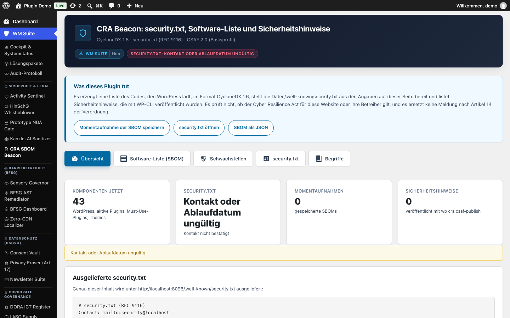
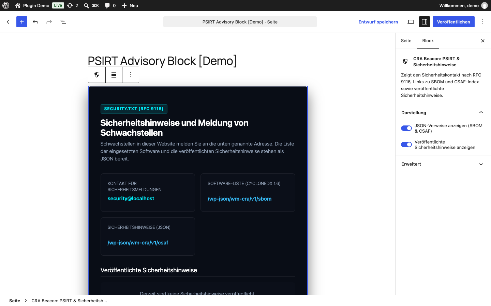
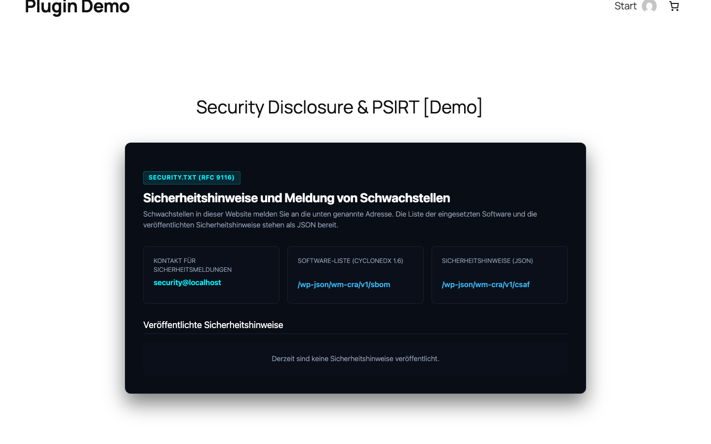

# WM CRA SBOM & Vulnerability Beacon

<p align="center">
  <a href="README.md"></a>
  <a href="README.de.md"></a>
  <a href="README.es.md"></a>
</p>

**Version:** 1.2.2 · **Requires WordPress:** 6.4+ · **Tested up to:** 7.1 · **Requires PHP:** 8.2+ · **License:** [GPLv2 or later](https://www.gnu.org/licenses/gpl-2.0.html) (`GPL-2.0-or-later`) · **UI Languages:** 28 locales · **Plugin Page:** [https://arnoldwender.com/wordpress-plugins/wm-cra-sbom-beacon/](https://arnoldwender.com/wordpress-plugins/wm-cra-sbom-beacon/)

WordPress plugin that lists the code a site runs as a CycloneDX 1.6 JSON inventory, serves `/.well-known/security.txt` (RFC 9116) from admin settings, and stores security advisories as CSAF 2.0 documents of the base profile.

This README was rewritten from the code. Earlier editions called the plugin an "EU Cyber Resilience Act (CRA) & BSI TR-03183 Suite", described a "PSIRT Incident Timeline Engine" for 24 h and 72 h notifications that never existed, promised PGP key references the settings could not set, and showed a "UI Showcase" mockup of screens the plugin does not have. Superseded banners and mockups were archived outside the repository on 2026-11-20 (release 1.2.0).

> **Plugin page:** [https://arnoldwender.com/wordpress-plugins/wm-cra-sbom-beacon/](https://arnoldwender.com/wordpress-plugins/wm-cra-sbom-beacon/)  
> **Built with an agentic workflow:** developed with AI coding agents. Review and test it like any third-party code before you use it in production.  
> **Support & Liability:** Zero support — reproducible bugs on [GitHub Issues](https://github.com/arnoldwender/wm-wp-cra-sbom-beacon/issues) only · no private support · AS IS / no liability ([SUPPORT.md](SUPPORT.md))

## Showcase

!WM CRA SBOM & Vulnerability Beacon banner

| Admin Overview | Gutenberg Block Editor | Public Disclosure Portal |
|---|---|---|
|  |  |  |

## What the plugin does

- **Software inventory (SBOM).** `GET /wp-json/wm-cra/v1/sbom`, `wp cra sbom-generate` and the admin tab build a CycloneDX 1.6 JSON document of WordPress core, the active plugins (site and network), must-use plugins, the active theme and its parent. Name, version, author and licence come from the file headers; a value the header does not state is left out. No file hashes are computed. All four JSON REST routes (`/sbom`, `/spdx`, `/vex`, `/csaf`) require `manage_options` or a timing-safe `Authorization: Bearer <token>` header by default (with only the token's SHA-256 digest stored in `wp_options`, or `WM_CRA_API_TOKEN` in `wp-config.php`), cache responses in 1-hour transients invalidated on plugin/theme/upgrader/advisory changes, and support an explicit opt-in public mode throttled to 60 requests/min per salted IP hash.
- **Bundled libraries.** The Composer packages and npm dependencies that those plugins and themes ship, read from their `composer.lock` and `package-lock.json`, with `pkg:composer/` and `pkg:npm/` purls a vulnerability database can match. Only lock files, never a manifest: a manifest states a range, a lock file states the installed version. Development dependencies are not listed (a distribution build does not install them) and a lock file inside `vendor/` or `node_modules` belongs to another project and is not read. A library two plugins bundle is one component that names both.
- **Runtime.** PHP with its version, the loaded extensions that wrap a library with its own release cycle, the database server (MariaDB is not reported as MySQL) and the web server banner. An extension that only reports PHP's own version gets none: `phpversion( 'openssl' )` returns the PHP version on a stock build, and `php-ext-openssl@8.5.10` would send a scanner after a release that does not exist. For `openssl` and `curl` the real library version is read instead.
- **Vulnerability audit (`wp cra vuln-scan`, daily cron, *Schwachstellen* tab).** The inventory is checked against the databases that hold data for it: Composer and npm packages go to **OSV** in one batched request, WordPress core, plugins and themes go to **NVD**. Each finding is matched against the *installed version* through the CVE's own CPE ranges, so a CVE fixed before the version in use is not reported.
- **Each source is asked only about what it holds.** Measured 2026-09-16: OSV accepts the ecosystems `WordPress`, `WordPress:Core`, `WordPress:Plugin` and `WordPress:Theme` but answers `{}` for `contact-form-7 5.7.1`, `elementor 3.5.0`, `wordpress 6.4` and `twentytwentyone`, and does not hold `CVE-2023-6553` at all. Sending plugins there would report "no vulnerabilities" for every site for ever — a check with no variance, which is worse than no check because it looks like one.
- **A component is never clean by default.** NVD allows five requests per 30 seconds without an API key, so one run checks a handful of components and a cursor remembers where it stopped. Every component carries a state — `checked` with a timestamp, `never_checked`, `unknown_version` or `source_error` — and the screen shows it. A database that could not be reached leaves its components in `source_error`, not in `checked`.
- **Cryptographic bill of materials (CBOM), off by default.** With *Kryptografische Verfahren mitaufnehmen* on the SBOM tab, or `wp cra sbom-generate --crypto`, the document also lists the hash algorithms, cipher methods and TLS versions this host offers as CycloneDX `cryptographic-asset` components — including the weak ones, which is the point of a crypto inventory. It is off by default because on a stock PHP 8.3 with OpenSSL 3.5 that is 186 further components.
- **Snapshots.** The admin button, `wp cra sbom-generate --snapshot` and the hub action store the JSON with its SHA-256 in the table `wm_cra_sbom_snapshots`; the admin tab lists the newest ten.
- **security.txt.** `/.well-known/security.txt` (and `/security.txt`) serves Contact, Expires, Encryption, Preferred-Languages, Canonical and Policy from five options, plus two comment lines pointing to the JSON outputs, filtered through `wm_cra_security_txt_output`. The settings tab validates each field (Contact as e-mail or https URL, Expires in the future and at most one year ahead, https URLs) and saves nothing when one is invalid.
- **State of the file.** Admin header, widget, hub health, Block Bindings (`wm-cra-beacon/status`), GenerateBlocks 2.x Dynamic Tag (`{{wm_cra_beacon_status}}`) and self test show one computed state: `ok`, `expiring` (30 days), `expired`, `invalid` (contact or Expires unusable), `no_route` (plain permalinks or rule not stored) or `not_configured`. The contact written on activation (`security@<host>`) counts as unconfirmed until an administrator saves the form.
- **Advisories.** `wp cra csaf-publish <id> --title=… --severity=low|medium|high|critical [--cve=…] [--description=…]` stores a CSAF 2.0 document (category `csaf_base`) with tracking, revision history and aggregate severity. Publishing the same id again raises the version and keeps the initial release date. Nothing is filled in: no CVE without `--cve`, no CVSS score.
- **SPDX 3.0.1 (`GET /wp-json/wm-cra/v1/spdx`, `wp cra spdx-generate`).** The same measurement as the CycloneDX document, in the format procurement asks for: JSON-LD against the published 3.0.1 context, `software_Package` elements with `software_packageVersion` and `software_packageUrl`, a `contains` relationship and a `software_Sbom` of type `deployed`. Every term and vocabulary entry was read from the specification: SPDX 3 renamed what SPDX 2 users know, and `Package` does not exist in the 3.0.1 context at all. A licence taken from a free-text file header goes into `comment`, not into a declared licence the plugin cannot verify.
- **OpenVEX (`GET /wp-json/wm-cra/v1/vex`, `wp cra vex`).** The site's position on each finding, as OpenVEX v0.2.0. **A finding nobody has assessed is published as `under_investigation`** — the label VEX has for exactly that — never as `not_affected`. `not_affected` requires one of the five VEX justification labels or a free-text impact statement, and `affected` requires saying what is to be done; both are refused without. The document version changes whenever its content does, a restatement raises the statement's own version and keeps the date the position was first taken, and a statement about a finding the scan no longer reports stays in the document rather than leaving a consumer with the old finding and no answer.
- **Advisory index.** `GET /wp-json/wm-cra/v1/csaf` lists the newest 50 documents in a plain JSON index. It is not a CSAF `provider-metadata.json` or ROLIE feed.
- **Public box, Gutenberg block & dynamic bindings.** Shortcodes `[wm_cra_psirt]` and `[wm_security_disclosure]` or the compiled Gutenberg block `wm/cra-psirt` (`blocks/cra-psirt/block.json` + `build/index.js` with `InspectorControls` and `ServerSideRender`) display the security contact, optional JSON links and published advisories. WordPress 6.5+ Block Bindings source `wm-cra-beacon/status` and GenerateBlocks 2.x Dynamic Tag `{{wm_cra_beacon_status}}` expose computed `security.txt` status fields.
- **Dashboard widget, WP-CLI, extensibility hooks & WM Suite Hub module** (`wm_cra_beacon_ready` action, `wm_cra_security_txt_output` and `wm_cra_sbom_include_crypto` filters, hub health, telemetry, actions `self_test` and `generate_sbom`).
- **Uninstall (`D-UNINSTALL`).** By default, uninstalling the plugin preserves all options and the 3 CRA Beacon database tables (`wm_cra_sbom_snapshots`, `wm_cra_advisories`, `wm_cra_vulnerabilities`) across reinstalls. Enabling `wm_cra_beacon_delete_data_on_uninstall` on the *security.txt* settings tab permanently deletes all plugin options, drops the tables and removes the guard-only `uploads/wm-cra/sbom` directory on uninstall.

All stylesheets and the Gutenberg block editor script ship locally with the plugin; zero external CDN assets are loaded.

## What it does not do

- **No legal assessment.** It does not check whether the Cyber Resilience Act (Regulation (EU) 2024/2847) applies to a site or its operator, and it produces no conformity documentation. See [docs/LEGAL-COMPLIANCE.md](docs/LEGAL-COMPLIANCE.md).
- **No reporting.** Article 14 CRA notifications (24 hours, 72 hours, 14 days, through the single reporting platform) are not covered.
- **Not a CSAF provider.** No `provider-metadata.json`, no ROLIE feed, no signed documents; documents do not claim the Security Advisory profile, which needs a product tree and product status the plugin cannot state.
- **Not a vulnerability scanner for WordPress plugins in the usual sense.** NVD indexes far fewer WordPress plugin vulnerabilities than the commercial feeds. Measured 2026-09-16, those feeds all require a key: Wordfence Intelligence v2 answers **410 Gone** and v3 **401**, Patchstack **401**, WPScan **403**. A plugin absent from NVD is reported as checked with no findings **in NVD**, which is not the same as safe.
- **No CVSS is computed.** A score is written only where the database states one; OSV states a vector rather than a number, and the vector is kept as it stands.
- **Not a full dependency list.** Inactive plugins are not listed, and bundled libraries are only found where the plugin ships a lock file — a `vendor/` directory committed without one is invisible. Nothing is read from a manifest, so a dependency whose version is only stated as a range is left out rather than guessed.

## Quick start

```bash
wp plugin activate wm-cra-sbom-beacon
wp cra security-txt                               # prints the served file and warns when its state is not ok
wp cra sbom-generate --output=/tmp/sbom.json      # or pipe: wp cra sbom-generate | jq '.components | length'
```

Then open *CRA Beacon (SBOM) › security.txt* in wp-admin, enter a real contact and an Expires date, and save.

## Tests

```bash
php tests/test-suite.php          # standalone: security.txt, activation, settings, SBOM, CLI, CSAF, hub, admin, portal, block, bindings, uninstall
bash tests/run-mutations.sh       # each entry in tests/mutations.php undoes one fix; the suite must turn red
php tests/test-pot-freshness.php  # every string the code translates has an entry in the .pot (needs wp-cli)
cd tests && ../vendor/bin/phpunit --configuration phpunit.xml.dist
wp eval-file tests/wp-runtime-cra.php --user=1    # inside WordPress; restores the options it touches
```

The mock `$wpdb` in the standalone suite evaluates the queries the plugin sends and throws on anything else; a PHP warning fails the run. CI runs PHPUnit, standalone suites on PHP 8.2 and 8.3, POT catalog freshness, and the mutation check on 8.3.

## Known issues

- **Sites activated before 2026-09-15** carry an activation Policy URL `/security-policy`, which may not exist and is `http://` on sites without TLS (refused by the form). The file stays unconfirmed until the form is saved.
- **Public box styling:** the shortcode/block markup keeps inline colours and sizes; it is not on design tokens.
- **Translations.** All 28 shipped locale catalogs (`.po`, `.mo`, and JED `.json` bundles for `build/index.js`) are translated across all 163 UI strings and verified against `languages/wm-cra-sbom-beacon.pot` via `tests/test-pot-freshness.php`.

## Documentation

- [docs/ARCHITECTURE.md](docs/ARCHITECTURE.md): classes, data, request flow
- [docs/DEVELOPER-GUIDE.md](docs/DEVELOPER-GUIDE.md): WP-CLI, REST, hooks, block bindings, hub, tests
- [docs/LEGAL-COMPLIANCE.md](docs/LEGAL-COMPLIANCE.md): what the plugin covers of the cited regulations and specifications, with sources
- [CHANGELOG.md](CHANGELOG.md)

## License

Licensed under the **GNU General Public License v2 or later** (`GPLv2 or later` / SPDX `GPL-2.0-or-later`). See [LICENSE](LICENSE) and <https://www.gnu.org/licenses/gpl-2.0.html>.
